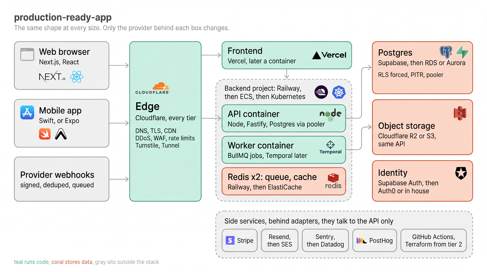

A Claude skill for building apps the way large companies do: start as a cheap MVP on managed providers, move to real infrastructure later without a rewrite. Backend and frontend separate, Postgres with RLS, rate limiting, caching, queues, a provider per tier and a migration playbook per layer.

## Install

    git clone https://github.com/ArvinAbrahamian1/production-ready-app ~/.claude/skills/production-ready-app

Then describe a project to Claude Code. The skill loads on its own whenever hosting, database, auth, caching, rate limiting, queues or scaling come up.

## Note

Prices and plan limits in the provider tables are November 2026 ballparks. Check the provider's page before relying on one. The picker rules and tier triggers are opinionated on purpose: one answer per layer.
